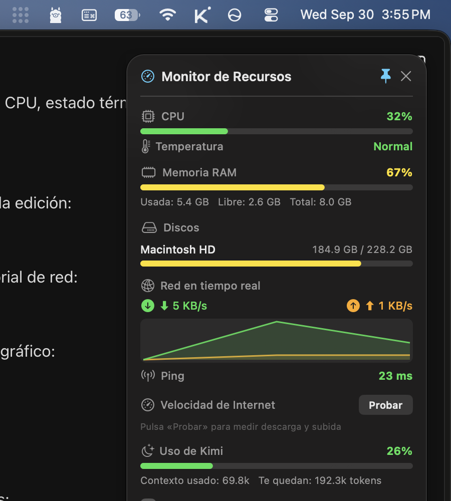
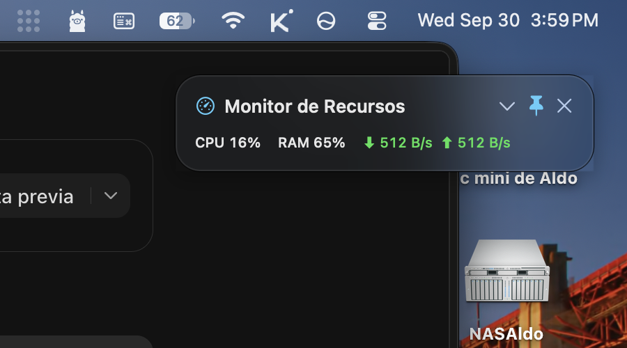

# Monitor Recursos — Widget de escritorio para macOS (Apple Silicon)

App nativa de macOS que muestra un **widget flotante en el escritorio** con el consumo de recursos del Mac en tiempo real.



Modo compacto (clic en el chevron del encabezado para plegar/expandir):



## Qué monitoriza

- **CPU**: porcentaje de uso total (todos los núcleos), con barra de progreso.
- **Temperatura**: estado térmico del sistema (Normal / Moderada / Alta / Crítica), según la API pública de macOS.
- **Memoria RAM**: usada, libre y total, con barra de progreso y porcentaje.
- **Discos duros**: todos los volúmenes montados (interno y externos), con espacio usado/total y barra de uso.
- **Red en tiempo real**: velocidad actual de descarga (⬇) y subida (⬆) de las interfaces físicas (Wi-Fi/Ethernet), con **gráfico histórico de los últimos 2 minutos**.
- **Ping**: latencia a 1.1.1.1 cada 10 segundos (verde < 50 ms, amarillo < 120 ms, rojo si es mayor o no hay respuesta).
- **Velocidad de Internet**: botón «Probar» que mide descarga y subida reales en Mbps contra los servidores de Cloudflare.
- **Uso de Kimi**: contexto consumido por la conversación activa de Kimi Work y tokens restantes (se lee del archivo local `conversation-context-usage.json` que la app de escritorio actualiza en vivo).

## Características del widget

- Ventana flotante sin bordes, siempre visible sobre las demás apps (se puede desactivar con el icono del 📌).
- **Modo compacto**: clic en el chevron (⌄) del encabezado para plegar el widget a una barra pequeña con solo CPU, RAM y red; otro clic lo expande de nuevo.
- Se puede arrastrar a cualquier posición del escritorio.
- Visible en todos los escritorios (Spaces).
- Sin icono en el Dock.
- Opción «Abrir al iniciar sesión» para que arranque solo al encender el Mac.
- Actualización automática cada 2 segundos (ping cada 10 s).

## Requisitos

- macOS 14 (Sonoma) o superior.
- Mac con procesador Apple Silicon (arm64).
- Xcode Command Line Tools (solo para compilar): `xcode-select --install`

## Instalar en otra Mac (Apple Silicon)

Hay dos caminos, según si la otra Mac tiene herramientas de desarrollo o no:

### Opción A — Copiar la app ya compilada (lo más fácil)

La app no tiene dependencias externas. Puedes pasarla suelta (`MonitorRecursos.app`)
o usar el instalador **`MonitorRecursos-1.0.dmg`** incluido en esta carpeta
(regenérable con `./make-dmg.sh`):

1. Copia `MonitorRecursos-1.0.dmg` a la otra Mac (AirDrop, USB, red local…).
2. Ábrelo con doble clic y **arrastra `MonitorRecursos.app` a la carpeta Aplicaciones**
   dentro de la ventana del DMG.
3. Como la app está firmada localmente (sin certificado de Apple), macOS puede bloquearla
   la primera vez. Para autorizarla, haz **una** de estas dos cosas:
   - Clic derecho sobre la app → **Abrir** → confirmar con **Abrir** en el diálogo; o
   - Abrir Terminal y ejecutar:
     ```bash
     xattr -dr com.apple.quarantine /Applications/MonitorRecursos.app
     ```
4. Doble clic para abrirla. Aparecerá el widget en la esquina superior derecha.
5. (Opcional) Dentro del widget, activa **«Abrir al iniciar sesión»** para que arranque
   sola cada vez que enciendas esa Mac.

> Solo funciona en Mac con procesador Apple Silicon (M1/M2/M3/M4…). Si la otra Mac es
> Intel, usa la opción B para recompilarla ahí.

### Opción B — Compilar desde cero en la otra Mac

1. Copia toda la carpeta `MonitorRecursosMac` a la otra Mac.
2. Instala las Xcode Command Line Tools (una sola vez):
   ```bash
   xcode-select --install
   ```
3. Compila e instala:
   ```bash
   cd MonitorRecursosMac
   ./build.sh
   ./install.sh
   ```

En ambos casos, la sección «Uso de Kimi» solo mostrará datos si en esa Mac también está
instalada la app de escritorio de Kimi Work (lee su archivo local de uso de contexto);
si no está, esa sección mostrará «Sin datos de uso» y el resto del widget funciona igual.

## Compilar e instalar (esta Mac)

```bash
./build.sh      # Compila y genera MonitorRecursos.app
./install.sh    # Copia la app a /Applications y la abre
```

También puedes simplemente arrastrar `MonitorRecursos.app` a tu carpeta de Aplicaciones
y hacer doble clic. La app está firmada localmente (firma ad-hoc), no necesita certificado
de desarrollador.

## Estructura del proyecto

```
MonitorRecursosMac/
├── build.sh                 # Script de compilación
├── install.sh               # Instalador (copia a /Applications)
├── make-dmg.sh              # Empaqueta la app en un DMG para compartir
├── MonitorRecursos-1.0.dmg  # Instalador listo para otras Macs
├── Info.plist               # Metadatos de la app
├── Sources/
│   ├── main.swift           # Punto de entrada y creación de la ventana flotante
│   ├── SystemMonitor.swift  # Recolección de datos: RAM (Mach), discos (statfs),
│   │                        # red (getifaddrs), ping (ICMP) y test de velocidad
│   └── WidgetView.swift     # Interfaz del widget (AppKit puro)
└── MonitorRecursos.app      # App compilada
```

## Notas técnicas

- Escrita en **Swift + AppKit** (sin dependencias externas, sin Xcode).
- La CPU se mide con `host_processor_info` (delta de ticks entre muestras, todos los núcleos).
- La temperatura usa `ProcessInfo.thermalState`: macOS no expone los °C de los sensores sin APIs privadas o root, así que se muestra el nivel térmico oficial del sistema.
- La RAM se lee con `host_statistics64` (API Mach del kernel).
- Los discos se enumeran con `mountedVolumeURLs` y capacidades reales vía `URLResourceValues`.
- El tráfico de red se calcula muestreando los contadores de bytes de `getifaddrs` cada 2 s; el gráfico guarda las últimas 60 muestras.
- El test de velocidad descarga 20 MB y sube 5 MB contra `speed.cloudflare.com`.
- El uso de Kimi se lee de `~/Library/Application Support/kimi-desktop/kimi-agent/conversation-context-usage.json` (solo lectura, no toca nada de la app).
